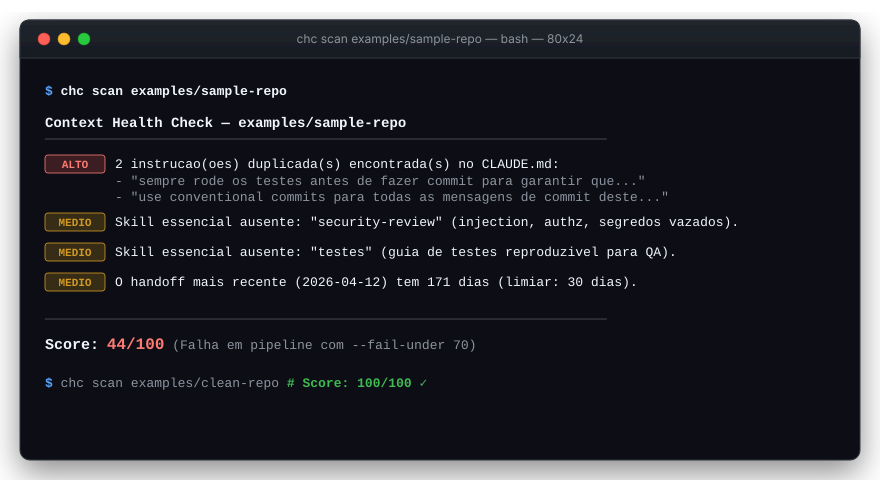

# claude-context-check (`chc`)

Linter CLI que audita a saúde do contexto de repositórios que utilizam Claude Code, detectando desperdício de tokens, instruções duplicadas e degradação de contexto antes do início da sessão do agente.

[Repositório](https://github.com/JoaoGabriellBR/claude-context-check) · [Como Rodar](#como-rodar) · [Regras Implementadas](#regras-implementadas)



## Funcionalidades

- **Prevenção de custos desnecessários em sessões (Cold Start):** Audita o volume acumulado do `CLAUDE.md` e dos metadados de skills antes da primeira mensagem, alertando quando instruções estáticas inflam o consumo fixo de tokens.
- **Detecção cirúrgica de instruções redundantes:** Identifica regras e comandos duplicados no arquivo de contexto do agente, eliminando sobrecarga cognitiva do modelo e riscos de comportamento conflitante.
- **Garantia de cobertura de boas práticas essenciais:** Verifica a presença de competências consolidadas do time (`code-review`, `security-review` e estratégias de `testes`), impedindo que o modelo improvise critérios de qualidade a cada sessão.
- **Auditoria de frescor de handoffs:** Alerta quando notas de continuidade de sprint ultrapassam 30 dias (dois ciclos ágeis), evitando que a IA tome decisões baseadas em premissas arquiteturais obsoletas.
- **Cálculo de pontuação objetiva (0 a 100):** Fornece uma métrica clara e acionável sobre a maturidade do repositório para engenharia agêntica com deduções calibradas pela severidade do problema.
- **Automação e bloqueio de esteiras de CI/CD:** Suporta exportação estruturada em JSON (`--json`) e trava de pipeline com código de erro configurável (`--fail-under <score>`) para barrar merges de contextos degradados.

## Stack

- **Linguagem & Runtime:** TypeScript 5.5 (`strict: true`), Node.js (>= 18 com test runner nativo `node:test`).
- **CLI & Parsing:** Commander.js 12 (interface de linha de comando), Chalk 4 (estilização ANSI), fast-glob (varredura de arquivos) e gray-matter (extração de frontmatter YAML).
- **Engenharia de LLM & Tokens:** Anthropic TypeScript SDK oficial (`@anthropic-ai/sdk` via `POST /v1/messages/count_tokens`) com fallback heurístico local e determinístico.
- **Deploy & Empacotamento:** Compilação TypeScript CommonJS/ES2020 (`dist/`), binário standalone executável (`bin: { "chc": "./dist/cli.js" }`) pronto para distribuição via npm/npx.

## Decisões técnicas

- **Motor de regras concorrente com assinatura polimórfica (`check: Finding[] | Promise<Finding[]>`)**  
  *Problema:* A maioria das checagens analisa arquivos locais em disco de forma síncrona instantânea, porém a contagem exata de tokens depende de requisição de rede (`POST /v1/messages/count_tokens`). Bloquear o event loop era inaceitável, e forçar `async` em regras puramente síncronas adicionaria sobrecarga em testes unitários.  
  *Escolha:* Definir a assinatura da regra como união `Finding[] | Promise<Finding[]>`, executando todas as checagens em paralelo com `Promise.all` em `runRules()`, mas concatenando e devolvendo os resultados na ordem de registro.  
  *Motivo:* Permite manter regras síncronas simples e sem `await` nos testes unitários, ao mesmo tempo em que garante saída 100% determinística no terminal e em logs de CI (a ordem dos findings não oscila com a latência de rede).  
  *Trade-off:* O orquestrador central precisa lidar com valores polimórficos internamente, mas isola essa complexidade dos módulos de regras.

- **API oficial de contagem de tokens vs. rejeição de tokenizers de terceiros (`tiktoken`)**  
  *Problema:* Medir tokens com fidelidade para modelos Claude em um linter estático sem forçar dependência de rede ou de chaves pagas para rodar a ferramenta.  
  *Escolha:* Consumir a rota oficial da Anthropic quando `ANTHROPIC_API_KEY` estiver configurada, degradando graciosamente para heurística local (~4 caracteres/token) explicitamente marcada como `[ESTIMATIVA APROXIMADA]`, rejeitando bibliotecas como `tiktoken` e `gpt-tokenizer`.  
  *Motivo:* Os tokenizers da OpenAI utilizam vocabulário BPE diferente e subestimam os tokens dos modelos Claude em 15% a 20% em texto comum e ainda mais em código-fonte indentado. Apresentar um número de outro modelo geraria uma falsa sensação de precisão; uma estimativa assumida é tecnicamente honesta e confiável.  
  *Trade-off:* Sem conexão ou chave configurada, a exatidão milimétrica é substituída por uma ordem de grandeza transparente para o desenvolvedor.

- **Validação temporal de handoffs por prefixo semântico de nome antes de `mtime`**  
  *Problema:* Identificar handoffs abandonados tanto no ambiente de desenvolvimento local quanto em esteiras de CI/CD.  
  *Escolha:* Priorizar a extração da data a partir do prefixo padronizado do arquivo (`YYYY-MM-DD`) com validação estrita de calendário, utilizando `fs.statSync().mtime` exclusivamente como fallback.  
  *Motivo:* O Git não armazena timestamps de modificação de arquivo (`mtime`). Durante operações de clone ou checkout em runners de CI (GitHub Actions), todos os arquivos recebem o timestamp do segundo exato do checkout. Uma regra puramente baseada em `mtime` consideraria um handoff de 6 meses atrás como recém-criado na esteira.  
  *Trade-off:* Requer adesão do time à convenção de nomenclatura com data (`YYYY-MM-DD-titulo.md`).

- **Validação de skills por identidade canônica (`name`/diretório) em vez de busca na `description`**  
  *Problema:* Assegurar que as competências essenciais (`code-review`, `security-review`, `testes`) estão configuradas sem disparar falsos positivos.  
  *Escolha:* Casar regex exclusivamente contra a identidade da skill (campo `name` do frontmatter YAML ou nome da pasta em `.claude/skills/<nome>/SKILL.md`), ignorando o campo textual `description`.  
  *Motivo:* É comum que a descrição de uma skill de `code-review` mencione palavras como "segurança" ou "execução de testes". Se a busca varresse o corpo da descrição, uma única skill satisfaria incorretamente todas as três checagens de governança.  
  *Trade-off:* Skills com nomes fora do padrão precisam definir explicitamente a propriedade `name` no frontmatter YAML.

- **Runner nativo `node:test` e zero dependências externas de teste**  
  *Problema:* Garantir uma suíte de testes rápida, estável e livre de dependências pesadas de teste.  
  *Escolha:* Utilizar o runner embutido `node:test` e asserções `node:assert/strict` integrados com `ts-node/register`.  
  *Motivo:* Elimina pacotes pesados como Jest/Vitest, reduz a superfície de vulnerabilidades na cadeia de suprimentos e entrega execução ultrarrápida (27 testes em ~4.6s).  
  *Trade-off:* Não conta com ecossistema de plugins prontos de frameworks maiores, o que foi resolvido com utilitários enxutos de teste (`helpers.ts`).

## Arquitetura

O `claude-context-check` opera como um pipeline linear e desacoplado:

```
[Repositório Alvo]
        │
        ▼
   scanner.ts          Varre disco, lê CLAUDE.md/CURRENT_TASK e extrai frontmatter YAML
        │
        ▼
   ScanContext         Estrutura imutável de dados com todo o contexto do repositório
        │
        ▼
 rules/index.ts        Orquestrador paralelo (Promise.all) com ordenação determinística
        │
        ▼
   Finding[]           Lista normalizada de problemas com severidade e scoreImpact
        │
        ▼
   scoring.ts          Cálculo com pontuação base 100 e deduções ponderadas (clamp [0, 100])
        │
        ▼
reporter.ts / cli.ts   Apresentação formatada via Chalk ou exportação estruturada em JSON
```

### Estrutura de pastas

```
src/
├── cli.ts                      # Entrada da CLI (Commander), flags (--json, --fail-under) e exit codes
├── index.ts                    # Exportação pública da biblioteca para integração programática
├── types.ts                    # Interfaces de domínio (ScanContext, Rule, Finding, Severity)
├── scanner.ts                  # Descoberta de arquivos, leitura de disco e parsing de YAML
├── scoring.ts                  # Algoritmo de pontuação com deduções calibradas
├── tokens.ts                   # Heurística ponderada de ~4 caracteres/token compartilhada
├── reporter.ts                 # Formatação de saída com badges ANSI no terminal
└── rules/                      # Regras desacopladas e extensíveis
    ├── index.ts                # Registro central e executor paralelo de regras
    ├── claude-md-rules.ts      # Checagem de existência, tamanho e instruções repetidas
    ├── skill-coverage-rules.ts # Checagem de cobertura das skills essenciais
    ├── handoff-rules.ts        # Frescor de handoffs (limiar de 30 dias / 2 sprints)
    └── token-budget-rules.ts   # Custo de cold start via Anthropic API ou fallback local
```

### Regras implementadas

| Regra | Severidade | Impacto | O que verifica |
|---|---|---|---|
| `claude-md-exists` | Crítico | -30 | Existência do `CLAUDE.md` na raiz do repositório. |
| `claude-md-size` | Médio | -10 | Tamanho do arquivo acima do recomendado (> 8.000 caracteres / ~2.000 tokens). |
| `claude-md-duplicate-lines` | Alto | -15 por item | Instruções redundantes ou duplicadas no `CLAUDE.md`. |
| `skill-coverage` | Médio | -8 por skill | Presença das 3 skills essenciais (`code-review`, `security-review`, `testes`). |
| `handoff-freshness` | Baixo / Médio | -5 / -10 | Existência de handoff (-5) e notas mais recentes com mais de 30 dias (-10). |
| `token-budget` | Baixo / Médio | -5 / -10 | Custo do cold start do agente (> 4.000 tokens = Baixo; > 10.000 = Médio). |

## Como rodar

### Pré-requisitos
- Node.js >= 18.0.0
- npm >= 9.0.0

### Instalação

1. Clone o repositório:
```bash
git clone https://github.com/JoaoGabriellBR/claude-context-check.git
cd claude-context-check
```

2. Instale as dependências:
```bash
npm install
```

3. Configure o ambiente (opcional, para contagem exata de tokens):
```bash
cp .env.example .env
# Adicione sua ANTHROPIC_API_KEY no .env se desejar contagem via API oficial
```

### Execução

```bash
# Compilar TypeScript para dist/
npm run build

# Escanear o repositório atual
npm start -- scan .

# Ou rodar diretamente em modo de desenvolvimento (sem build manual)
npm run dev -- scan .

# Testar com os fixtures demonstrativos incluídos
npm run scan:sample    # Repositório com instruções duplicadas e skills ausentes (Score ~44)
npm run scan:clean     # Repositório organizado conforme as boas práticas (Score 100/100)

# Saída estruturada em JSON (ideal para automações e dashboards)
npm start -- scan . --json

# Falhar a execução (exit code 1) se o score ficar abaixo do limiar (ideal para CI/CD)
npm start -- scan . --fail-under 70
```

## Testes

```bash
npm test
```

- **Cobertura:** 27 testes automatizados divididos em 11 suítes cobrindo caminhos positivos e negativos de todas as regras, parsing de frontmatter YAML, ordenação determinística concorrente e integridade matemática da pontuação.
- **Isolamento de rede garantido:** A suíte de testes desativa dinamicamente quaisquer chaves de API do ambiente (`tests/fixtures.test.ts`), exercitando e assegurando o caminho de fallback offline sem chamadas externas nem consumo de saldo.
- **Fixtures reais e transitórios:** Validações de ponta a ponta contra fixtures estáticos (`examples/`) e repositórios temporários gerados em tempo de execução com datas relativas (`helpers.ts`).

## Uso de IA

- **Onde ajudou:** Prototipação dos fixtures em `examples/` para reproduzir repositórios com contextos problemáticos, auxílio na escrita das expressões regulares para desconsiderar cabeçalhos markdown na detecção de duplicatas e estruturação de casos de borda para datas de calendário gregoriano.
- **Onde eu decidi:** Modelagem da matriz de penalidades do scoring (balanceamento relativo de severidades), decisão de não usar tokenizers OpenAI devido a discrepâncias de BPE, arquitetura híbrida de execução concorrente com ordenação determinística e estratégia de resolução temporal imune a clones em ambientes de CI/CD.

## Limitações e próximos passos

- [x] Detecção de instruções redundantes no `CLAUDE.md` com descarte de linhas triviais
- [x] Auditoria de skills essenciais de engenharia (`code-review`, `security-review`, `testes`)
- [x] Auditoria de frescor de handoffs com validação por data autorada para compatibilidade com CI
- [x] Contagem de cold start com integração oficial à API da Anthropic e fallback local
- [x] Suíte completa de testes automatizados com runner nativo `node:test`
- [ ] Publicação do pacote no registro npm para execução direta via `npx claude-context-check`
- [ ] Criação de GitHub Action oficial para comentar o relatório de contexto diretamente em Pull Requests
- [ ] Implementação de flag interativa `--fix` para remoção automática de instruções duplicadas no `CLAUDE.md`
- [ ] Suporte a arquivo de configuração (`.chcrc.json`) para personalização de pesos e limiares de tokens por equipe

## Autor

João Gabriel Silva · [LinkedIn](https://linkedin.com/in/joaogabriel-silva) · [GitHub](https://github.com/JoaoGabriellBR) · [Email](mailto:joaoname9@gmail.com)
